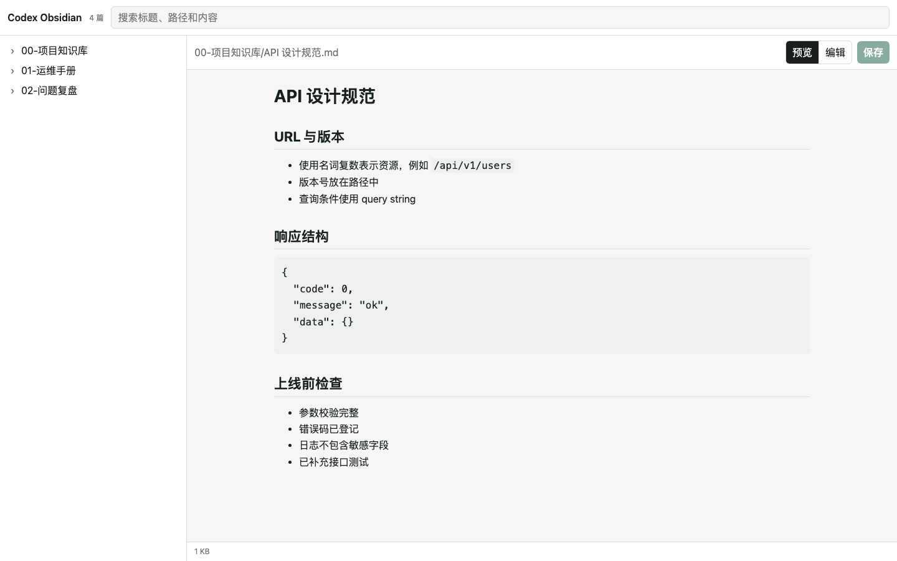

# Codex Obsidian

在本机浏览器或 Codex 内置浏览器中，浏览、搜索、预览和编辑你的 Obsidian Markdown 笔记。

项目采用本地优先设计：Vault 内容不上传、不写入仓库，Web 服务默认只监听 `127.0.0.1`。



## 功能

- Obsidian 风格的目录树
- 按文件名、路径和正文搜索
- Markdown 预览与源码编辑
- `[[Wikilink]]` 跳转
- 保存前修改时间检查，避免覆盖外部编辑
- 原子写入，降低保存中断造成文件损坏的风险
- 路径穿越和符号链接逃逸防护
- 自动忽略 `.obsidian`、`.git`、`.trash` 和 `node_modules`
- 响应式布局和深色模式

## 隐私边界

仓库不包含任何用户笔记、Vault 路径、账号、API Key 或访问令牌。运行时只读取你通过 `OBSIDIAN_VAULT_PATH` 指定的本地目录。

请勿把以下内容提交到 Git：

- Obsidian Vault 或笔记副本
- `.env` 文件
- 包含私人目录名或笔记正文的截图
- 日志、账号、密码、API Key 和 Token

## 环境要求

- Node.js 20 或更高版本
- 一个本地 Obsidian Vault

## 快速开始

```bash
git clone https://github.com/vonwen/codex-obsidian.git
cd codex-obsidian
npm install

export OBSIDIAN_VAULT_PATH="/绝对路径/你的 Obsidian Vault"
npm start
```

浏览器打开：

```text
http://127.0.0.1:43128/
```

也可以在 Codex 内置浏览器中打开这个地址，边开发边查看笔记。

## 配置

| 环境变量 | 默认值 | 说明 |
|---|---|---|
| `OBSIDIAN_VAULT_PATH` | 无，必填 | Obsidian Vault 的绝对路径 |
| `CODEX_OBSIDIAN_HOST` | `127.0.0.1` | 服务监听地址 |
| `CODEX_OBSIDIAN_PORT` | `43128` | 服务端口 |

出于隐私考虑，不建议把监听地址改成 `0.0.0.0`。如果确实需要局域网访问，应先增加身份认证和 HTTPS。

## macOS 登录后自动启动

```bash
chmod +x scripts/install-macos.sh
./scripts/install-macos.sh "/绝对路径/你的 Obsidian Vault"
```

安装脚本会创建用户级 LaunchAgent。查看状态：

```bash
launchctl print "gui/$(id -u)/com.vonwen.codex-obsidian"
```

## 开发与测试

```bash
npm run check
npm test
```

测试使用临时目录，不读取真实 Vault。

## 安全说明

- 服务仅设计为本机单用户工具，没有内置登录系统。
- Markdown HTML 会经过清理，但仍建议只打开可信的个人 Vault。
- 图片中的远程 URL 可能向图片服务器发出网络请求。
- 保存操作会直接修改原 Markdown 文件，建议对 Vault 使用 Git、Time Machine 或其他备份。

## 公众号文章

完整的使用场景和设计思路见 [docs/公众号文章.md](docs/公众号文章.md)。

## License

[MIT](LICENSE)
