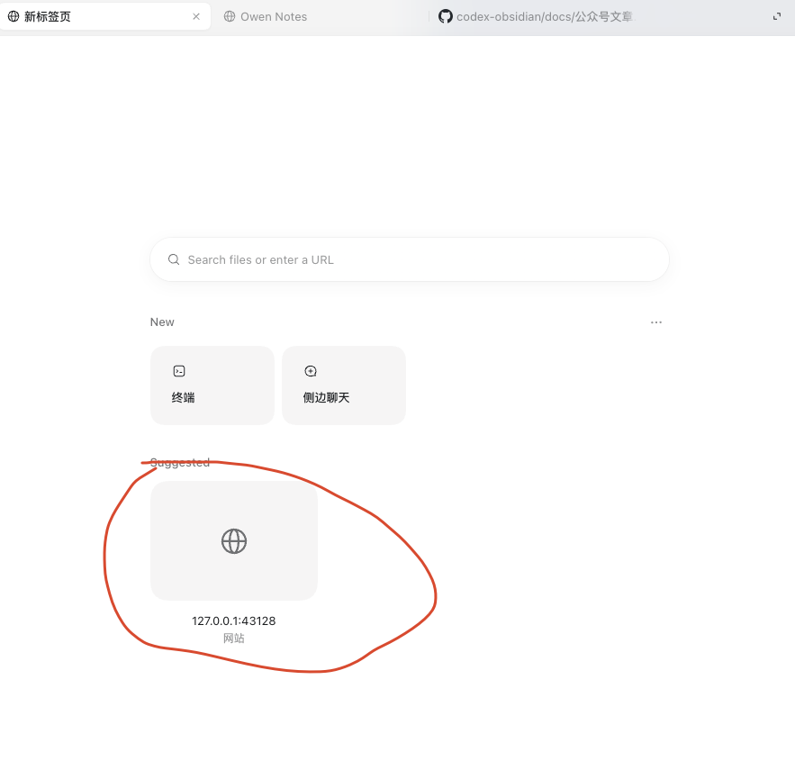

# 给 Codex 一个不会失忆的大脑：我用 Obsidian 管理多项目的完整开发记忆

我同时使用 Codex 开发多个项目。

每个项目开始时，都要做需求梳理、技术选型和 Plan 规划；开发过程中，还会不断产生新的章节、关键要点、接口约定、部署步骤和问题复盘。

真正让我头疼的，不是 AI 不会写代码，而是这些重要信息很容易散落。

一部分留在某次对话里，一部分写在临时文件中，还有一部分只存在于当时的思路里。几天后切换到另一个项目，再回来继续时，人需要重新回忆，AI 也要重新理解。

最熟悉的一句话就是：

> “这个问题我们之前讨论过，但当时最后为什么这样决定？”

如果没有持续维护的项目记忆，新的 Codex 会话只能根据眼前代码和零散描述重新推测。推测一多，前后不一致、重复设计和 AI 幻觉也就跟着出现了。

所以我想做的，从来不只是“在 Codex 里打开 Markdown”。

我真正需要的是：**让 Codex 和我共用同一个 Obsidian 记忆库，把项目从开始到结束的完整过程持续保存下来。**

项目地址：

<https://github.com/vonwen/codex-obsidian>

## 为什么我把 Obsidian 当作项目记忆库

人的记忆并不可靠，AI 会话的上下文同样不是永久记忆。

一个项目经历几周甚至几个月后，真正有价值的不只是最终代码，还包括：

- 为什么选择当前技术方案
- 哪些方案讨论过但被放弃了
- Plan 被拆成了哪些阶段和章节
- 每个阶段有哪些关键约束
- 接口、数据库和目录结构如何约定
- 开发过程中遇到了什么问题
- 问题最后如何定位和解决
- 上线、回滚和交付时需要注意什么

这些内容决定了项目的连续性。

如果只保留代码，我们看到的是“结果”；如果把计划、决策和复盘也保存下来，我们才拥有项目完整的“记忆”。

我原本就使用 Obsidian 记录技术资料，因此最自然的方式不是再建立一套新知识库，而是让 Codex 直接使用现有的 Obsidian Vault。

## 我希望项目从第一天就开始形成记忆

现在我的理想工作方式是：每个项目从创建开始，就同步建立自己的项目记忆结构。

```text
项目首页
├── 00-项目背景与目标
├── 01-需求与范围
├── 02-总体 Plan
├── 03-架构与设计决策
├── 04-阶段任务与关键要点
├── 05-接口与数据约定
├── 06-开发过程记录
├── 07-问题与复盘
├── 08-部署与回滚
└── 09-交付总结
```

这不是为了写更多文档，而是为了让信息有固定的位置。

Codex 在规划阶段生成 Plan 时，可以同步整理成章节；完成一个阶段后，把关键变更和未解决问题追加进去；遇到故障时，记录现象、根因和处理方法；项目结束时，再形成一份可以交接和复用的总结。

这样，项目不再只有一串对话和一堆代码，而是形成一条可以持续追踪的记忆链。

## 为什么还要把笔记浏览器放进 Codex

以前我需要在 Codex 和 Obsidian 之间来回切换。

写代码时想查一条记录，就切到 Obsidian；找到笔记后复制内容，再回到 Codex。几分钟后需要更新计划，又重复一遍。

每次切换只花几秒钟，但思路会被不断打断。更麻烦的是，笔记和开发现场始终像两个独立世界：Codex 在生成内容，我还要记得稍后把它整理进 Obsidian。

所以我给 Codex 增加了一个本地 Obsidian 笔记浏览器。

安装完成后，本地站点会成为 Codex 内置浏览器中的快捷入口：



*点击本地站点即可进入笔记库，不必单独打开 Obsidian。*

进入后，可以直接浏览完整目录，搜索标题、路径和正文，也可以预览、编辑并保存 Markdown：


*这是我实际使用的本地笔记库。公开截图已对当前笔记路径和正文做模糊处理。*

## Codex 和 Obsidian 如何共用同一套记忆

浏览器解决的是“我如何方便地查看和编辑”；Codex 对本地 Vault 的文件访问解决的是“AI 如何读取和追加”。

在我的使用环境中，我为 Codex 指定了 Obsidian Vault，并约定：

- 新项目先创建项目首页和总体 Plan
- 规划结果要形成结构化 Markdown，而不是只留在对话中
- 重要设计决定写明背景、选择和原因
- 每完成一个阶段，就追加进度、关键变更和下一步
- 遇到问题就形成复盘，避免相同错误重复出现
- 新会话开始时，先读取相关项目笔记，再继续工作
- 项目结束时补齐部署、交付和总结章节

于是，Codex 可以随时生成、随时追加，我也可以在旁边立即查看和修正。

Obsidian 继续负责长期保存与知识组织，Codex 负责在开发现场读取、生成和更新。两边使用的是同一批 Markdown 文件，不需要复制，也不需要维护两套内容。

## 它怎样减少 AI 开发中的“幻觉”

AI 幻觉无法靠一个笔记工具彻底消除，但很多开发中的错误并不是模型完全不会，而是上下文不完整。

例如：

- 新会话不知道之前已经否决过某个方案
- AI 不清楚项目特有的接口和命名约定
- 多个项目之间的技术要求被混淆
- 上一次讨论的计划没有被带入下一次执行
- 代码已经变化，但旧的设计背景没有保存

持续维护的项目记忆，可以为 Codex 提供一套更稳定的事实来源。

它让 AI 少一点猜测，多一点查证；少一点临时发挥，多一点沿着既定计划继续推进。

但我也给自己保留一条原则：**笔记是上下文，不是绝对真相。** 关键设计、生产操作和安全配置仍然需要人工检查，过期内容也需要及时更新。

## 实际使用中最方便的几个地方

### 1. 多项目之间更容易切换

每个项目都有独立的计划、约定和进度记录。切换项目时，先读取对应记忆，而不是依靠人和 AI 从头回忆。

### 2. Plan 不再随着会话结束而消失

规划会变成可以持续修改的章节。完成了什么、为什么调整、下一步是什么，都能留下明确记录。

### 3. 项目过程更加完整

从需求、设计、开发、排障到部署和交付，不再只保留最终代码。以后维护、复盘和交接时，能看到完整来龙去脉。

### 4. 笔记随时生成、随时追加

Codex 得出一个值得保留的结论时，可以直接整理进 Obsidian；我在浏览器中看到不准确的内容，也可以马上编辑。

### 5. 经验可以跨项目复用

故障复盘、部署清单和技术规范不再只服务于一个项目。以后遇到相似问题，可以从记忆库中快速找到以前验证过的经验。

## 数据仍然留在本机

我不希望为了方便查看笔记，就把私人资料或公司项目上传到另一个平台。

Codex Obsidian 采用本地优先设计：

- 默认只监听 `127.0.0.1`
- Vault 路径在运行时由用户指定
- GitHub 仓库不包含任何真实笔记
- 只允许读取和编辑 Markdown 文件
- 阻止路径穿越和符号链接逃出 Vault
- Markdown 渲染结果经过 HTML 清理
- 保存时检查外部修改，降低覆盖冲突风险
- 使用临时文件和原子替换保存

它仍然会直接修改真实笔记，因此重要 Vault 应当有 Git、Time Machine 或其他备份。也不要为了远程访问而直接监听 `0.0.0.0`；跨设备开放前，应先增加认证和 HTTPS。

## 三分钟开始使用

准备 Node.js 20 或更高版本：

```bash
git clone https://github.com/vonwen/codex-obsidian.git
cd codex-obsidian
npm install

export OBSIDIAN_VAULT_PATH="/你的/Obsidian Vault/绝对路径"
npm start
```

然后在 Codex 内置浏览器中打开：

```text
http://127.0.0.1:43128/
```

macOS 用户还可以配置为登录后自动启动：

```bash
chmod +x scripts/install-macos.sh
./scripts/install-macos.sh "/你的/Obsidian Vault/绝对路径"
```

## 最后

AI 编程工具让写代码变快了，但项目能否长期保持清晰，取决于计划、决策和经验有没有被可靠地保存。

我希望 Codex 不只是完成眼前的一次任务，而是能够沿着整个项目生命周期持续工作；也希望每一次规划、修改和踩坑，都能成为下一次开发可以调用的记忆。

Obsidian 是我的记忆库，Codex 是我的开发助手。

当它们开始共用同一套项目记忆后，AI 不再只面对当前这一轮对话，而是能够站在过去积累的上下文上继续前进。

这就是我做 Codex Obsidian 的原因。

项目已开源：

<https://github.com/vonwen/codex-obsidian>

欢迎试用，也欢迎提交 Issue 和改进建议。
