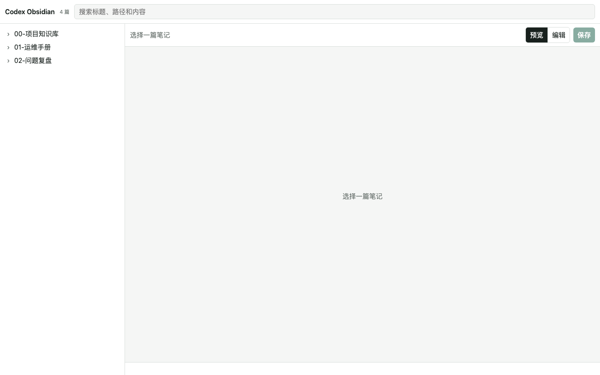
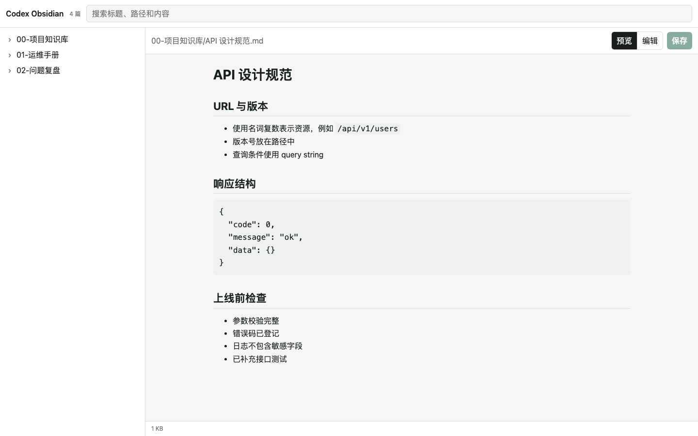
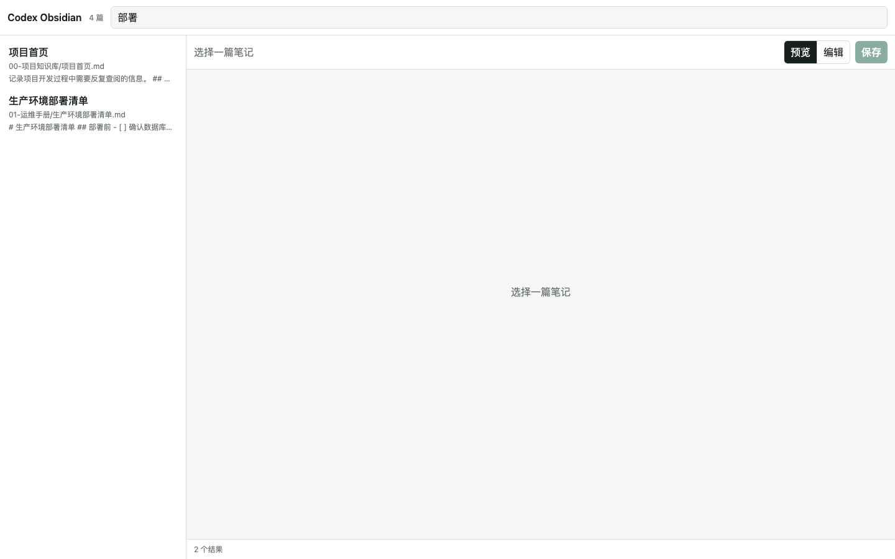

# 让 Obsidian 成为我的记忆库：我把笔记带进了 Codex

人的记忆并不可靠。

一个问题今天解决了，过几个月再次遇到，脑海里只剩下一句：“这个我以前处理过。”至于当时执行了什么命令、为什么这样设计、踩过哪些坑，往往已经想不起来。

所以我一直把 Obsidian 当作自己的第二记忆：技术方案、操作记录、项目约定、排障过程和突然冒出来的想法，能留下来的尽量留下来。

但记录下来，并不等于真正用起来。

我在 Codex 里处理代码时，经常忽然想起 Obsidian 中有一篇相关笔记。于是切换窗口、翻目录、搜索关键词、复制内容，再切回 Codex。看起来只是几个小动作，却足以让刚刚连起来的思路断掉。

我们缺少的不是更多笔记，而是让记忆在需要它的那一刻，出现在手边。

于是我做了一个小工具：**Codex Obsidian**。它把我的 Obsidian 笔记库放进 Codex 的内置浏览器，让笔记和代码出现在同一个工作现场。



*左侧浏览目录，右侧查看内容，整个服务只运行在本机。截图使用虚构演示笔记。*

项目地址：

<https://github.com/vonwen/codex-obsidian>

## 当记忆库来到开发现场

Codex Obsidian 会在本机启动一个轻量 Web 服务，把指定的 Obsidian Vault 变成可以在 Codex 内置浏览器中使用的笔记浏览器。

左边是熟悉的目录树，右边是笔记内容。可以搜索、预览，也可以直接编辑保存。开发过程中不需要离开当前工作空间，就能随手查看：

- 项目的部署步骤和回滚命令
- API 约定、数据库字段和排障记录
- 以前解决过的相似问题
- 团队流程、代码规范和检查清单
- 临时记录下来的思路与待办

现在，遇到不确定的命令，我可以在旁边直接搜索；看到过期的记录，也可以当场修改。少切换一次窗口，看起来只节省几秒钟，真正保住的却是连续思考的状态。



*Markdown 会直接渲染，代码块、列表和标题都能保持清晰的阅读结构。*

## 为什么我愿意长期使用它

### 1. 笔记仍然是普通 Markdown

它没有创建新的数据格式，也没有把笔记导入某个封闭系统。你的文件仍在原来的 Obsidian Vault 中，Obsidian、编辑器、Git 和备份工具都可以继续使用。

工具只是为记忆库增加一个入口，不接管数据，也不改变原来的使用习惯。

### 2. 本地优先，不上传笔记

服务默认只监听 `127.0.0.1`，也就是只允许当前电脑访问。Vault 路径通过环境变量在运行时指定，仓库中没有任何用户笔记、个人目录、账号或密钥。

对于工作记录、项目方案和私人知识库，这个边界很重要：我想要更方便地使用记忆，而不是把记忆交给另一个平台。

### 3. 目录浏览和全文搜索同时存在

有时我们记得笔记放在哪个目录，有时只记得正文中的一个词。因此工具同时提供 Obsidian 风格的树形目录和内容搜索。

人通常记得内容，却未必记得文件放在哪里。目录适合按结构寻找，全文搜索适合凭一个模糊的关键词唤回记忆，两种方式缺一不可。



*既能搜索文件名和路径，也能从正文内容中找回相关记录。*

### 4. 查看与编辑在同一个界面

记忆库不是档案馆，它需要持续更新。查到过期命令时，可以立即切换到编辑模式修正；保存后仍然是原来的 Markdown 文件。为了避免覆盖 Obsidian 或其他编辑器刚刚写入的内容，保存时会检查文件修改时间，发现冲突就停止覆盖。

### 5. 对 Obsidian 链接更友好

常用的 `[[Wikilink]]` 会转换为可点击链接，可以沿着笔记之间的关系继续阅读。因为真正有价值的记忆从来不是一篇篇孤立的文档，而是彼此关联的经验。

## 记忆库首先要让人安心

这个项目还做了几项必要的防护：

- 只允许读取和编辑 `.md` 文件
- 阻止 `../` 路径穿越
- 阻止符号链接逃出 Vault
- 忽略 `.obsidian`、`.git` 和回收站等内部目录
- Markdown 渲染结果经过 HTML 清理
- 保存使用临时文件和原子替换
- 默认不对局域网开放

当然，它仍然是一个会修改真实笔记的工具。重要 Vault 应当有 Git、Time Machine 或其他备份。也不要为了远程访问而直接把监听地址改成 `0.0.0.0`；需要跨设备访问时，应先补上认证与 HTTPS。

## 三分钟开始使用

准备 Node.js 20 或更高版本，然后执行：

```bash
git clone https://github.com/vonwen/codex-obsidian.git
cd codex-obsidian
npm install

export OBSIDIAN_VAULT_PATH="/你的/Obsidian Vault/绝对路径"
npm start
```

浏览器打开：

```text
http://127.0.0.1:43128/
```

在 Codex 内置浏览器中打开同一个地址，就能把笔记放在开发界面旁边。macOS 用户还可以运行仓库中的安装脚本，将服务配置为登录后自动启动：

```bash
chmod +x scripts/install-macos.sh
./scripts/install-macos.sh "/你的/Obsidian Vault/绝对路径"
```

## 谁可能需要它

如果你同时符合下面两三项，这个工具大概率能减少日常摩擦：

- 使用 Obsidian 管理技术笔记
- 经常在 Codex 中处理代码和运维任务
- 不愿把私人或公司笔记上传到第三方知识库
- 希望知识记录与实际开发更靠近
- 经常遇到“我明明写过，但现在找不到”的情况

它并不打算代替 Obsidian。Obsidian 依然负责完整的知识管理体验；Codex Obsidian 只是让这套记忆库在开发现场多一个足够近、足够快的入口。

## 最后

AI 编程工具让生成代码变快了，但真正决定效率的，仍然是正确的上下文能否及时到达。自己的笔记、历史决策和踩坑记录，往往比一次全新的搜索更接近眼前的问题。

我越来越觉得，Obsidian 的价值不只是“记笔记”，而是替未来的自己保留记忆。Codex Obsidian 所做的事情很简单：在需要这些记忆的时候，让它们离我更近一点。

把记忆库放到开发现场旁边，不是多装一个工具，而是少遗忘一次经验，少打断一次思考。

项目已开源：

<https://github.com/vonwen/codex-obsidian>

欢迎试用，也欢迎提交 Issue 和改进建议。
